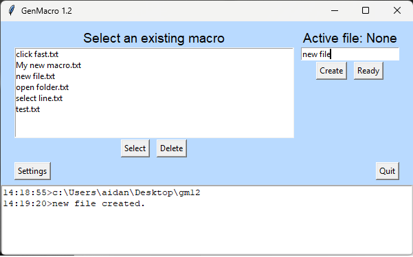
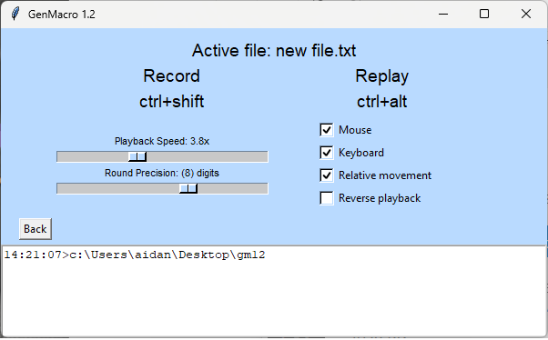
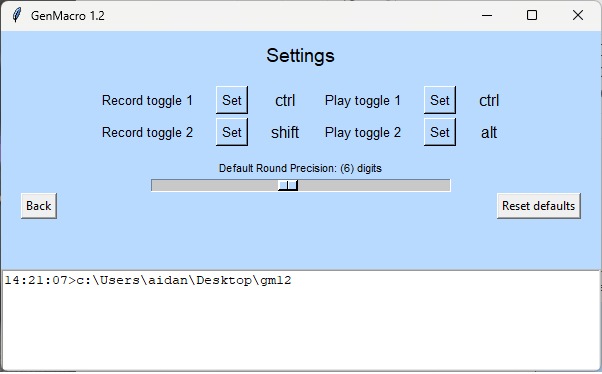

# GenMacro

Intended to simplify the macro creation and management process. 

## In this update (1.2)

- Consolidated the old interface
- Removed 3 inefficient menus
- Console now tells the time
- Added toggle for mouse recording/playback
- Added toggle for keyboard recording/playback
- Added toggle for reverse playback
- Added slider for round precision 

## Features

- File management
- In-app console

- Create: Record and save macros
- Run: Replay saved macros
- Toggleable hooks
- Reverse playback

- Settings: Modify keybinds and precision timings
- File loading interface: Options to select, create, and delete files

## Dependencies

- [keyboard](https://github.com/boppreh/keyboard)
- [mouse](https://github.com/boppreh/mouse)
- Windows (2 lines)

## Known issues

- Replaying a file recorded on a different screen size does not currently work

## More to come

- Conversion to desktop application (.exe)
- UI feedback and optimizations 
- Support for scheduling macros in succession or on command
- Support for screen size
- Automated visual checking process 
